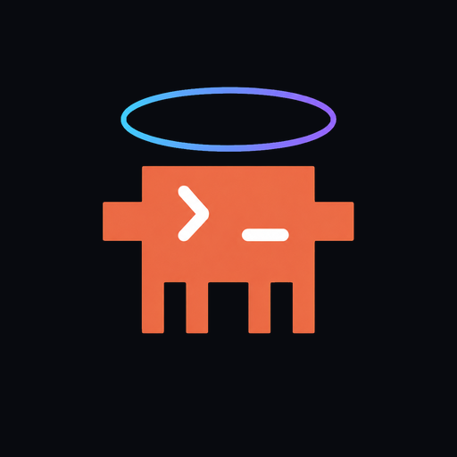
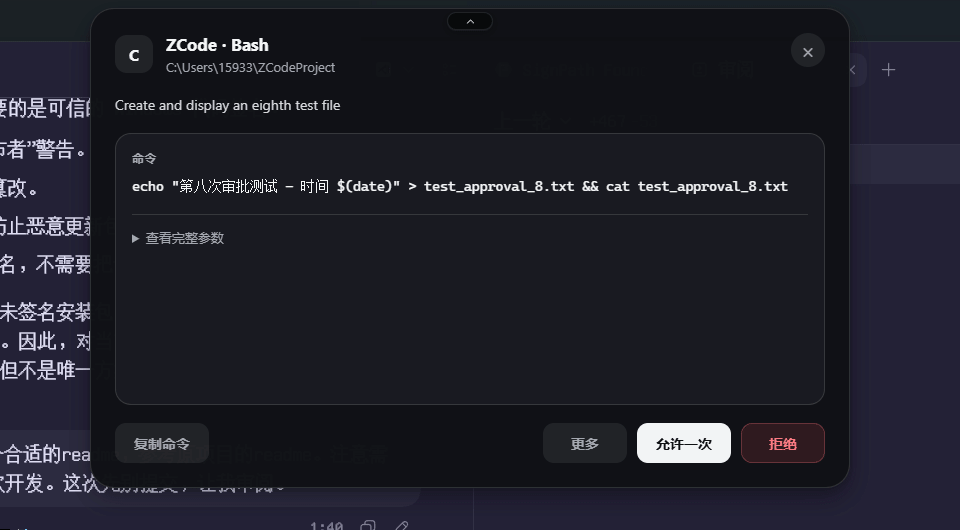

# Vibe Halo

<p align="center"></p>

**English** · [简体中文](README.zh-CN.md)

A desktop Dynamic Island for AI coding clients: handle supported approvals and questions, and see when a task needs attention or finishes. An optional Android companion brings paired notifications, approvals and history to your phone.


[](LICENSE)



## Download

| Platform | Package | Status |
| --- | --- | --- |
| Windows x64 | [NSIS installer](https://github.com/DaliBerr/Vibe-Halo/releases/latest) | Stable; explicit-restart updates |
| macOS 12+ | [Apple Silicon / Intel DMG and ZIP](https://github.com/DaliBerr/Vibe-Halo/releases/tag/preview-0.6.3) | Preview; ad-hoc signed, not notarized |
| Linux x64 | [AppImage / deb](https://github.com/DaliBerr/Vibe-Halo/releases/tag/preview-0.6.3) | Preview |
| Android 8+ | [Signed companion APK](https://github.com/DaliBerr/Vibe-Halo/releases/download/v0.6.3/Vibe-Halo-Mobile-0.6.3.apk) | Preview; Xiaomi background settings need device verification |

Windows packages may show an unknown-publisher warning. Preview desktop packages have automatic updates disabled. Codex and ZCode have real-client coverage on Windows; macOS/Linux have CI packaging and smoke coverage. Other integrations remain subject to client compatibility.

## What it does

- One desktop approval queue, with native-client fallback when no valid decision is made.
- Structured answers where the client exposes an exact answer protocol; Codex questions remain reminders to answer in Codex.
- Codex mid-turn async questions also reach the paired phone, even with desktop input reminders disabled. Unanswered async reminders survive turn completion and unrelated prompts, until answered, dismissed or timed out (up to 30 minutes). Requires desktop 0.6.4; Android 0.6.3 and the existing relay remain compatible.
- Completion notifications and optional tray-opened recent-event history.
- Paired Android notifications, explicitly authorized remote control, readable history cards and editable device names.
- Phone/watch notifications show the client and a short task preview; updated phones deduplicate LAN/cloud delivery, and Codex follow-up suggestions no longer trigger completion alerts.
- Markdown and Codex cards in phone records; encrypted project-image snapshots from new completion/plan records, with tap-to-zoom viewing.
- Codex completion/plan titles use the local chat-name index when available. Phone record details show a compact colored status badge below the title; list cards show a matching status dot and short label.
- English/Chinese UI with system light/dark appearance.

The registry includes 19 integrations with different capabilities. See the [client support table](docs/GUIDE.md#client-support).

## Get started

1. Install and launch Vibe Halo. Open **Client integrations** from the tray and check your client's setup.
2. For Codex, review Vibe Halo's command hooks with `/hooks` when requested.
3. To connect Android, open **Phone companion** on the computer and follow the phone's pairing wizard. Compare fingerprints before completing pairing; enable remote control on the computer only if needed.
4. On Android, allow notifications and follow the background-settings guidance. Manufacturer-specific settings may need adjustment on the device.

The desktop connects to the default companion relay automatically; you can disable remote access in companion settings. Pairing is required to connect a phone. The original Hook server stays loopback-only, and companion traffic is encrypted. History can contain task content; review the [privacy and security details](docs/GUIDE.md#security-and-privacy).

## Development

Use Node.js 24 and npm:

```sh
npm ci
npm test
npm start
```

Android development also requires JDK 21 and Android SDK 36. Build instructions and configuration are in the guides below.

## Documentation

- [User and contributor guide](docs/GUIDE.md): integrations, troubleshooting, architecture and local builds.
- [Android companion setup](docs/REMOTE_SETUP.md): pairing, Firebase, self-hosting and Android builds.
- [Release guide](docs/RELEASING.md): packages, signing and updates.
- [Report a bug](https://github.com/DaliBerr/Vibe-Halo/issues): include OS/client versions and reproduction steps; omit secrets and private task content.

## License and attribution

Derived from [Clawd on Desk](https://github.com/rullerzhou-afk/clawd-on-desk), independently maintained with a focused island interface and an independently implemented Android companion. Not affiliated with the upstream maintainers or supported client vendors.

Licensed under [AGPL-3.0-only](LICENSE). Retain upstream attribution and comply with source-availability obligations; see [NOTICE.md](NOTICE.md).
