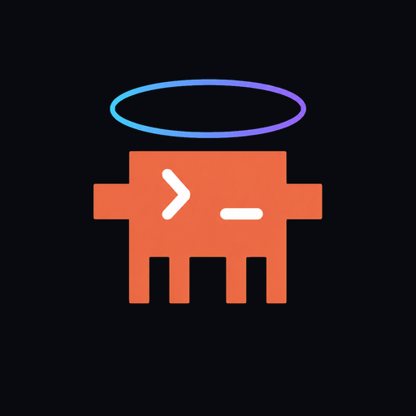
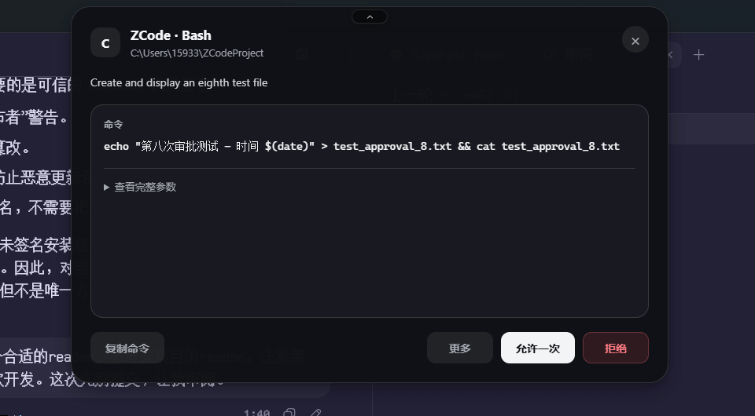

# Vibe Halo

<p align="center"></p>

<p align="center"><strong>A Dynamic Island for AI coding clients on Windows.</strong><br>
Approve tool calls, answer questions and see when a task finishes — without switching windows.</p>

<p align="center">
  
  
  <a href="LICENSE"></a>
</p>

**English** · [简体中文](README.zh-CN.md)



## Highlights

- **Approvals in one place** — every client's permission requests share one queue at the top of your screen. Close or ignore a request and the client simply asks natively, so nothing is ever approved by accident.
- **Answer questions in the island** — clients with an exact answer protocol (Claude Code, ZCode, DeepSeek Harness, Hermes) can be answered without leaving your editor.
- **Reminders and completion notices** — know when a client is waiting for you or a task is done.
- **One settings window** — General, Recent events, Mobile companion and each of your clients (with its app icon) in a single sidebar. Choose per client what it may show.
- **Phone companion (optional)** — paired, encrypted Android notifications, history and explicitly authorized remote decisions.
- English/Chinese UI that follows your system light/dark appearance.

## Download

| Platform | Package |
| --- | --- |
| Windows 10/11 x64 | [Installer (latest release)](https://github.com/DaliBerr/Vibe-Halo/releases/latest) — updates install after you confirm a restart |
| Android 8+ | [Companion APK 0.6.7](https://github.com/DaliBerr/Vibe-Halo/releases/download/v0.6.7/Vibe-Halo-Mobile-0.6.7.apk) — preview |

The installer is not publisher-signed, so Windows may show an unknown-publisher warning. Only Windows is released; macOS and Linux packages are no longer published.

## Get started

1. Install and launch Vibe Halo. **Settings** opens on first launch; later open it from the tray (**Settings…**) or by clicking the tray icon.
2. **Codex**, **Claude Code** and **DeepSeek Harness** are on by default. Other detected clients can be shown under **General → Clients in the sidebar**, then turned on from their own page.
3. Codex asks you to trust new hooks: run `/hooks` in Codex and approve the Vibe Halo entries (the Codex page offers **Copy /hooks**).
4. Optional: open **Mobile companion** in Settings to pair an Android phone. Compare the fingerprint on both devices before confirming.

## Supported clients

20 integrations are available, each with different capabilities: approvals, exact answers, reminders or completion notices. Codex, ZCode, DeepSeek Harness and Claude Code have been checked with the live client on Windows; the others are covered by contract tests. See the [client support table](docs/GUIDE.md#client-support).

## Privacy

The hook server listens only on `127.0.0.1` with a per-launch token. Recent events stay on this computer (encrypted when the system allows it). The phone companion is encrypted end to end and needs explicit pairing; remote decisions stay off until you allow them on the computer. Details: [security and privacy](docs/GUIDE.md#security-and-privacy).

## Development

```sh
npm ci
npm test
npm start
```

Node.js 24 and npm. The Android companion additionally needs JDK 21 and Android SDK 36.

## Documentation

- [User and contributor guide](docs/GUIDE.md) — integrations, troubleshooting, architecture and local builds
- [Android companion setup](docs/REMOTE_SETUP.md) — pairing, Firebase, self-hosting and Android builds
- [Release guide](docs/RELEASING.md) — Windows releases, signing and updates
- [Report a bug](https://github.com/DaliBerr/Vibe-Halo/issues) — include Windows and client versions; leave out secrets and private task content

## License

Derived from [Clawd on Desk](https://github.com/rullerzhou-afk/clawd-on-desk) and independently maintained; not affiliated with the upstream maintainers or any supported client vendor. Licensed under [AGPL-3.0-only](LICENSE); see [NOTICE.md](NOTICE.md) for attribution, including the bundled client icons.
