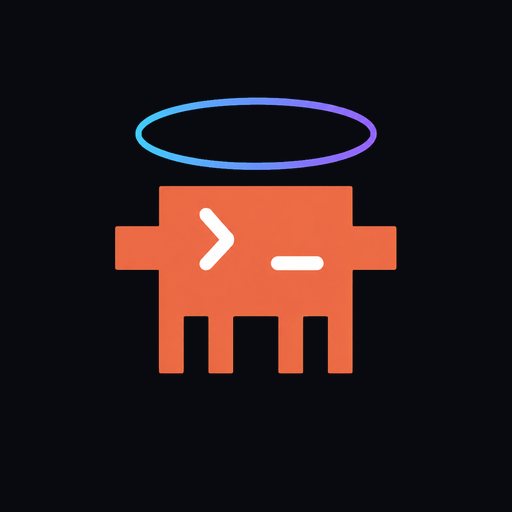
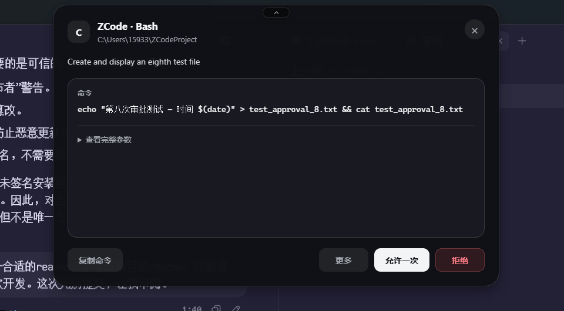

# Vibe Halo

<p align="center"></p>

<p align="center"><strong>Windows 上的 AI 编程客户端灵动岛。</strong><br>
批准工具调用、回答提问、得知任务完成——都不用切换窗口。</p>

<p align="center">
  
  
  <a href="LICENSE"></a>
</p>

[English](README.md) · **简体中文**



## 亮点

- **审批集中处理**：所有客户端的权限请求进入屏幕顶部的同一个队列。关闭或不处理时，客户端会照常在自己的界面里询问，绝不会被误批准。
- **在灵动岛里回答提问**：支持精确答案协议的客户端（Claude Code、ZCode、DeepSeek Harness、Hermes）无需离开编辑器即可作答。
- **等待提醒与完成通知**：客户端在等你、或者任务完成时及时提示。
- **统一的设置窗口**：侧边栏包含通用、最近事件、手机伴侣和你的各个客户端（带应用图标），可按客户端分别选择要显示的内容。
- **手机伴侣（可选）**：配对后的加密 Android 通知、历史记录，以及需要你明确授权的远程决定。
- 中英文界面，跟随系统深浅色。

## 下载

| 平台 | 安装包 |
| --- | --- |
| Windows 10/11 x64 | [安装程序（最新版）](https://github.com/DaliBerr/Vibe-Halo/releases/latest)——确认重启后安装更新 |
| Android 8+ | [伴侣 APK 0.6.7](https://github.com/DaliBerr/Vibe-Halo/releases/download/v0.6.7/Vibe-Halo-Mobile-0.6.7.apk)——预览版 |

安装程序未签名，Windows 可能提示未知发布者。现在只发布 Windows 版，不再发布 macOS 和 Linux 安装包。

## 快速上手

1. 安装并启动 Vibe Halo。首次启动会打开“设置”；之后可从托盘“设置…”打开，或直接单击托盘图标。
2. **Codex**、**Claude Code** 和 **DeepSeek Harness** 默认开启。其他检测到的客户端可在“通用 → 侧边栏中的客户端”中显示，再到它自己的页面开启。
3. Codex 会要求你信任新的 Hook：在 Codex 中运行 `/hooks` 并批准 Vibe Halo 的条目（Codex 页面提供“复制 /hooks”按钮）。
4. 可选：在设置中打开“手机伴侣”配对 Android 手机，确认前请核对两端显示的指纹。

## 支持的客户端

共提供 20 种客户端集成，能力各不相同：审批、精确回答、等待提醒或完成通知。Codex、ZCode、DeepSeek Harness 和 Claude Code 已在 Windows 上用真实客户端检查过，其余集成由契约测试覆盖。详见[客户端支持表](docs/GUIDE.zh-CN.md#客户端支持)。

## 隐私

Hook 服务只监听 `127.0.0.1`，每次启动生成新令牌。最近事件只保存在本机（系统支持时会加密）。手机伴侣全程加密且必须配对；远程决定默认关闭，需要你在电脑上明确开启。详见[安全与隐私](docs/GUIDE.zh-CN.md#安全与隐私)。

## 本地开发

```sh
npm ci
npm test
npm start
```

需要 Node.js 24 和 npm；Android 伴侣还需要 JDK 21 和 Android SDK 36。

## 文档

- [使用与开发指南](docs/GUIDE.zh-CN.md)：集成、排障、架构和本地打包
- [Android 伴侣配置](docs/REMOTE_SETUP.md)：配对、Firebase、自托管与 Android 构建
- [发布指南](docs/RELEASING.md)：Windows 发布、签名和更新
- [反馈问题](https://github.com/DaliBerr/Vibe-Halo/issues)：请附上 Windows 和客户端版本，不要上传密钥或私人任务内容

## 许可证

本项目源自 [Clawd on Desk](https://github.com/rullerzhou-afk/clawd-on-desk)，独立维护，与上游维护者及所支持的客户端厂商均无关联。采用 [AGPL-3.0-only](LICENSE) 许可；署名信息（包括内置的客户端图标）见 [NOTICE.md](NOTICE.md)。
